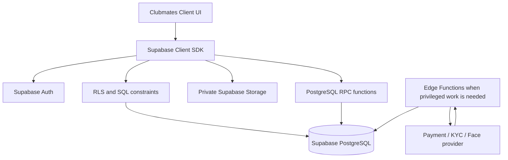

# Clubmates — Architecture

**Status:** Phase 1 implementation baseline  
**Product:** Clubmates, a social nightlife discovery app—not a conventional dating app  
**Primary experience:** Club → Likes → Mates → Profile  
**Architecture principle:** Keep the first release lean. Use Supabase directly from the client for ordinary user-scoped operations, and introduce trusted backend code only where secrets, provider integrations, or privileged decisions require it.

---

## 1. Goals and non-goals

### Phase 1 goals
- Authenticate users with Supabase Auth.
- Create and edit a profile.
- Upload and manage profile photos.
- Discover eligible profiles.
- Pass on a profile or send an invite.
- View incoming/outgoing invites.
- Accept or decline an invite; accepted invites create a Mate connection atomically.
- Block another user.
- Protect user data with Row Level Security (RLS).
- Keep the schema small and migration-driven.

### Not in Phase 1 unless the product owner explicitly adds them
- Paid boosts, subscriptions, payment ledger, refunds.
- Aadhaar/PAN/KYC or face verification integrations.
- Chat/messages, push notifications, analytics pipeline.
- Venue booking, live maps, location tracking, recommendation/ML ranking.
- A separate always-on Go API server.
- Kafka, Redis, microservices, or a custom authentication system.

## 2. Technology choices

| Concern | Phase 1 choice | Notes |
|---|---|---|
| Client | Continue with the existing app framework | Do not rewrite the UI framework as part of this task. Confirm whether the repository uses Flutter or React before adding dependencies. |
| Authentication | Supabase Auth | Never store passwords in application tables. Use `auth.users` as the identity source. |
| Database | Supabase PostgreSQL | Use migrations in source control. |
| Authorization | PostgreSQL RLS + SQL grants | RLS is required on every client-exposed table. |
| Photos | Supabase Storage | Private bucket, user-scoped object paths, restrictive policies. |
| Normal data access | Existing client + Supabase SDK | UI calls a repository/service layer; no custom API proxy for ordinary CRUD. |
| Multi-row critical action | PostgreSQL RPC | Invite response + Mate creation must be atomic. |
| Trusted integrations | Supabase Edge Functions (TypeScript/Deno), when needed | Use for provider secrets, payment/KYC initiation, webhook verification, and privileged actions. Do not implement these integrations in Phase 1 unless needed for launch. |
| Preferred general-purpose backend language | Go | Keep Go as the preferred option if a standalone backend becomes justified. Do not add a Go service merely to proxy Supabase CRUD. |
| Hosting for a future Go service | Managed container platform such as Google Cloud Run | Add only when there is a concrete need for a long-running API, external integrations, or complex domain logic. |
| Secrets | Supabase Edge Function secrets / hosting secret manager | Never ship secrets or the Supabase `service_role` key to the client. |

### Go versus Supabase Edge Functions
The user's Go preference is recorded. For this first draft, a separate Go backend would add deployment, authentication propagation, monitoring, and maintenance without improving ordinary Supabase CRUD. Use direct client-to-Supabase calls plus database RPC/RLS. If a server-side integration is required, use the smallest trusted execution path. Edge Functions are the simplest Supabase-native option; if a project requirement specifically requires Go, deploy a small Go service (for example on Cloud Run) for that integration only. Never move provider secrets into the client to avoid writing backend code.

## 3. High-level system diagram



## 4. Phase 1 data model

Keep these seven application tables as the initial target. Supabase-managed `auth.users` remains the authentication source.

1. `profiles`
   - Public-facing fields only: `id`, `display_name`, `bio`, `city`, `gender`, `height_cm`, server-managed `is_verified`, server-managed `account_status`, timestamps.
   - `id` references `auth.users(id)`.
   - Never place phone number or full date of birth here.

2. `user_private`
   - `user_id`, `date_of_birth`, `discoverable`, `onboarding_completed`, timestamps.
   - Owner-only RLS.
   - Enforce adult eligibility in database logic and again for sensitive actions.

3. `profile_photos`
   - `id`, `user_id`, `storage_path`, `display_order`, `is_primary`, `moderation_status`, `created_at`.
   - Images live in Storage; database stores paths and metadata.
   - Users cannot self-approve moderation.

4. `passes`
   - `user_id`, `target_user_id`, `created_at`.
   - Unique `(user_id, target_user_id)`; disallow self-pass.

5. `invites`
   - `id`, `sender_id`, `receiver_id`, `status`, optional short `message`, timestamps.
   - Prevent duplicate pending invites in the same direction.
   - No direct client writes; use `create_invite` and `respond_to_invite` RPCs.

6. `mates`
   - Canonically ordered `user_one_id` and `user_two_id`, status, timestamp.
   - Unique pair; created only by trusted transactional logic.

7. `user_blocks`
   - `blocker_id`, `blocked_id`, timestamp.
   - Used to exclude blocked pairs from discovery and invite actions.

Do not create tables for interests, chat, notifications, payments, KYC, face verification, audit logs, preferences, or devices until a Phase 1 requirement needs them. Add migrations later rather than speculative tables now.

## 5. Which calls go directly from the client?

All calls must go through a small feature repository/service layer, not be scattered across UI widgets/components. This layer still calls Supabase directly; it is not a custom backend.

| Feature/action | Path | Notes |
|---|---|---|
| Sign up, sign in, sign out, session refresh | Client → Supabase Auth | Auth SDK; never implement password storage. |
| Read/update own public profile | Client → Postgres | RLS limits row access; server-managed fields must not be client-editable. |
| Read/update own private onboarding fields | Client → Postgres | Owner-only RLS; DOB remains private. |
| Read active public profiles | Client → Postgres/RPC | Only safe public fields; do not expose DOB, phone, exact coordinates, or private metadata. |
| Upload/delete own photo | Client → Storage | Private bucket and user-owned object path. |
| Register/reorder own photo metadata | Client → Postgres | Validate object path belongs to `auth.uid()`; do not allow client to set approved status. |
| Read approved profile photos | Client → Storage/Postgres | Restrict to active profiles and respect blocks. Prefer signed URLs if bucket policy design requires them. |
| Read active interest catalog | Later phase | Not required in first seven-table scope. |
| Save a pass | Client → Postgres | RLS and unique constraint; consider a small RPC if product rules grow. |
| Read own passes | Client → Postgres | RLS owner-only. |
| Send invite | Client → `create_invite` RPC | RPC derives sender from `auth.uid()`, validates recipient, blocks, age/account eligibility and duplicate pending invite. |
| Read incoming/outgoing invites | Client → Postgres | RLS allows only sender or receiver to read. |
| Accept/decline invite | Client → `respond_to_invite` RPC | Receiver-only; atomically updates invite and creates/reuses Mate. |
| Read own Mate connections | Client → Postgres | RLS restricts to participants. |
| Block/unblock user | Client → Postgres | RLS restricts block ownership; discovery and invite logic must honor blocks both ways. |
| Account deletion request | Client initiates; trusted process completes | Deleting Auth identity affects cascades; Storage cleanup and provider deletion need an explicit deletion workflow. Do not promise full deletion from a client-side delete alone. |

**Important:** Direct client calls are not inherently insecure when RLS and SQL privileges are correct. Never trust a client-supplied `user_id`; derive the acting user from the authenticated session inside RLS/RPC.

## 6. What must use trusted backend code?

| Operation | Phase 1? | Trusted path |
|---|---|---|
| Mark profile verified | No real verification in initial prototype | Provider callback / Edge Function or Go service; client cannot set it. |
| Aadhaar/PAN/identity verification | Defer | Provider integration in Edge Function or Go backend; store minimum status/reference only. Never store raw ID numbers/documents unless lawfully necessary. |
| Face/liveness verification | Defer | Provider integration in trusted backend; never store biometric templates by default. |
| Payment initiation, confirmation, refunds, boosts | Defer | Trusted backend creates provider session and verifies signed webhooks; never trust a client success callback. |
| Provider webhooks | Defer until integration | Public endpoint validates signature, replay/idempotency and provider event before updating records. |
| Admin moderation / suspension | Minimal admin workflow later | Trusted server-side role/claims and audited privileged actions; never rely on a client flag. |
| Invite acceptance / Mate creation | Phase 1 | PostgreSQL RPC with transactional behavior; callable from client, but logic executes in the database. |
| Photo moderation approval | Basic status placeholder only | Trusted moderation/admin workflow sets status; client cannot approve its own photos. |
| Scheduled cleanup / data retention | Later or before public launch | Trusted scheduled job/function; define policy before collecting sensitive data. |

Do not use a Go server as a proxy for every database query. Use Go only when a concrete trusted server-side integration or domain requirement warrants it.

## 7. Security rules

- Enable RLS on all tables reachable through the Data API.
- Review both SQL privileges and RLS policies; one does not replace the other.
- Never expose `service_role`, provider API secrets, webhook secrets, or signing keys in client code.
- Treat `is_verified`, account status, moderation status, payment state, and role assignments as server-managed.
- Use constraints and unique indexes as the final integrity guard.
- Add rate limiting for invites, reports, uploads and authentication abuse before public launch.
- Store the minimum location needed (for Phase 1, city is enough); do not expose precise coordinates.
- Private photo bucket; enforce per-user paths and MIME/size restrictions. Validate actual file content server-side before public launch.
- Keep DOB/private fields out of public discovery responses.
- Use generic error messages where detailed errors could reveal whether a target account exists.
- Do not store raw Aadhaar/PAN, document images or biometric templates by default.
- Plan account deletion across Auth, database, Storage and providers.

## 8. Client code organization

Use the repository's existing framework and conventions. A suggested logical structure:

```text
src-or-lib/
  features/
    auth/
    profile/
    photos/
    discovery/
    invites/
    mates/
    safety/
  data/
    supabase_client
    repositories/
      auth_repository
      profile_repository
      photo_repository
      discovery_repository
      invite_repository
      mate_repository
      block_repository
  models/
  routing/
  shared/
```

Use the equivalent idioms for the current stack. Do not create an abstraction for every individual SQL query; repositories should reflect app features and keep UI components free of authorization/business logic.

## 9. Environments and migrations

- Use a development Supabase project first.
- Keep SQL migrations in version control (for example, `supabase/migrations/`).
- Do not rely on manually edited production schema as the source of truth.
- Store client URL and anon/publishable key in environment configuration; the anon/publishable key is designed for client use but only safe with correct RLS.
- Keep server secrets in the Supabase secret store or backend secret manager.
- Have separate development and production credentials/projects.
- Seed only non-sensitive test profiles; do not use real identity documents for testing.

## 10. Definition of done for architecture

- Authenticated user can only change their own private data.
- Client cannot self-verify, self-suspend/unsuspend, approve photos or alter payment status.
- Discovery returns display-safe fields only and excludes self, passed users, relevant invite states, mates and blocks.
- Invite acceptance is atomic and cannot be performed by the sender or a third party.
- A duplicate Mate pair cannot be created.
- One user cannot read another user's private fields or upload/delete another user's Storage objects.
- Tests run with at least two accounts and cover allowed and denied operations.
